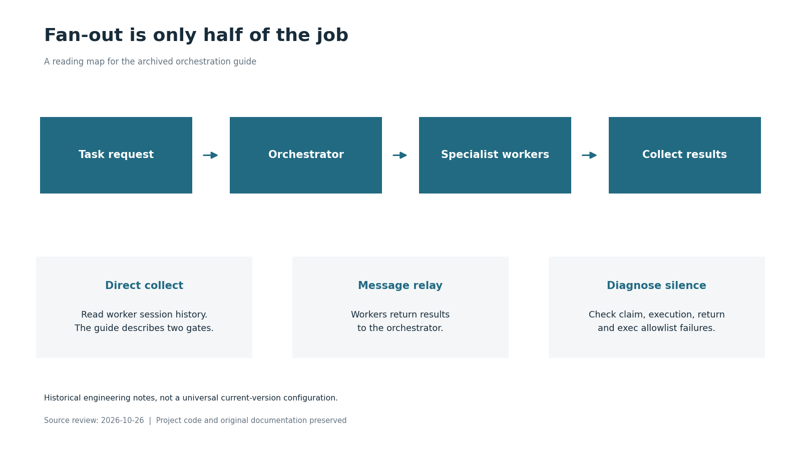
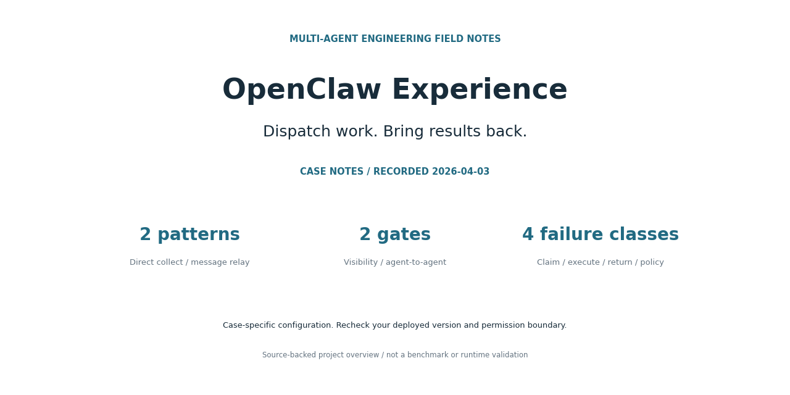

# OpenClaw Experience 图文素材

状态：**CASE NOTES / RECORDED 2026-04-03**。这些图片根据现有源码或文档制作，流程图属于说明图，并非运行截图；本次没有重新验证应用运行或外部服务。

## 项目封面

[查看原图](cover.png)

## 工作流程与边界

[查看原图](workflow.png)

## 社交分享封面

[查看原图](social-preview.png)

## 图中信息依据

- [multi-agent/openclaw-multi-agent-orchestration-guide-v2.md](https://github.com/wongzijie/OpenClaw-Experience/blob/8f40e71450b0ac25361f2d26885c65c07856abed/multi-agent/openclaw-multi-agent-orchestration-guide-v2.md)

图片指纹及来源版本见 [manifest.json](manifest.json)。
